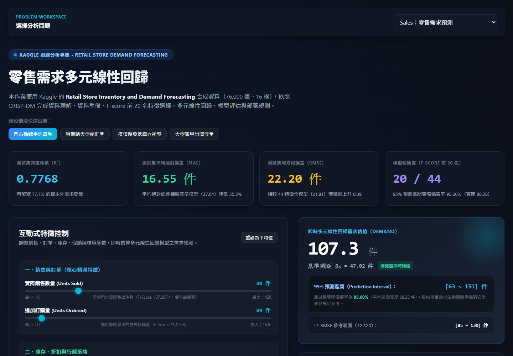
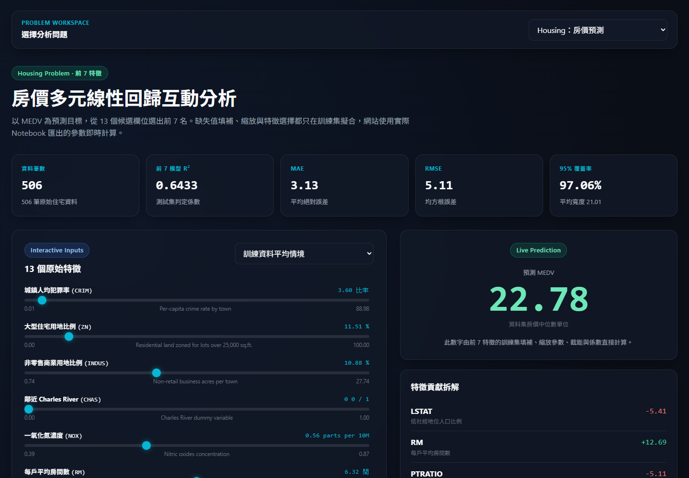

# Sales 與 Housing 多元線性回歸網站

本專案包含兩個可獨立重現的資料分析問題，以及一個共用的 Next.js 互動網站。網站上方的 **Problem** 下拉選單可切換：

- [Sales：零售需求預測](./sales/README.md)：以 `Demand` 為目標，使用前 20 名特徵線性回歸，保留既有 PDF report。
- [Housing：房價預測](./housing/README.md)：以 `MEDV` 為目標，從 13 個候選特徵選前 7 名，不製作 report，完整內容寫在 README。

GitHub Pages：https://cheeefds.github.io/hw2/

## 網站畫面

### Sales



### Housing



## 資料夾結構

```text
hw2/
├─ sales/                         # Sales 資料、Notebook、結果、測試與 report
│  ├─ sales_data.csv
│  ├─ 7115056075_hw2.ipynb
│  ├─ results/
│  ├─ scripts/
│  ├─ tests/
│  └─ README.md
├─ housing/                       # Housing 資料、Notebook、結果與測試
│  ├─ HousingData.csv
│  ├─ housing_analysis.ipynb
│  ├─ results/
│  ├─ scripts/
│  ├─ tests/
│  └─ README.md
├─ selected_project_web/          # 共用 Next.js 靜態網站
│  ├─ components/
│  ├─ model/
│  └─ public/images/
│     ├─ sales/
│     └─ housing/
├─ selected_project_web/public/images/sales/
├─ selected_project_web/public/images/housing/
└─ tests/                         # 跨問題一致性測試
```

內層 `hw2/` 是原始重複副本，本次只從中取得 `HousingData.csv`，沒有刪除或修改該副本。

## 安裝分析環境

目前 Sales 與 Housing 使用相同的主要 Python 套件。可先安裝任一資料夾的 requirements：

```powershell
python -m pip install -r sales/requirements.txt
```

如果系統無法直接找到 `python`，請改用本機 Python 的完整路徑。

## 重新產生 Sales Notebook

```powershell
cd sales
python scripts/build_hw2_notebook.py
python -m jupyter nbconvert --to notebook --execute 7115056075_hw2.ipynb --output 7115056075_hw2.ipynb --ExecutePreprocessor.timeout=600
cd ..
```

Sales 的實測結果會輸出至 `sales/results/`。詳細方法、指標與 report 請查看 [sales/README.md](./sales/README.md)。

## 重新產生 Housing Notebook

```powershell
cd housing
python scripts/build_housing_notebook.py
python -m jupyter nbconvert --to notebook --execute housing_analysis.ipynb --output housing_analysis.ipynb --ExecutePreprocessor.timeout=600
cd ..
```

Housing 會產生 `metrics.json`、模型比較 CSV、前 7 特徵 CSV 與三張圖。完整 CRISP-DM、結果與限制位於 [housing/README.md](./housing/README.md)。

## 執行全部 Python 測試

```powershell
python -m pytest tests sales/tests housing/tests -q
```

若 pytest 無法使用系統 Temp，可指定專案內暫存目錄：

```powershell
python -m pytest tests sales/tests housing/tests -q --basetemp .pytest_tmp
```

## 本機啟動網站

```powershell
cd selected_project_web
npm ci
npm run dev
```

開啟 `http://localhost:3000`，使用頁面頂部下拉選單切換 Sales 與 Housing。

## 建置與驗證靜態網站

```powershell
cd selected_project_web
npm ci
npm run build
npm run verify:config
npm run verify:export
npm run verify:interaction
Test-Path .\out\index.html
```

`verify:interaction` 使用電腦既有的 Microsoft Edge，以 headless 模式檢查兩個 problem 的切換、Housing 13 個輸入、即時預測更新、狀態隔離、圖片替代文字與 390 px 手機寬度。

## GitHub Pages 部署

`.github/workflows/deploy-pages.yml` 會在推送到 `main` 後：

1. 安裝網站套件。
2. 執行 Next.js 靜態建置。
3. 驗證 GitHub Pages base path 與匯出內容。
4. 上傳 `selected_project_web/out` 並部署。

網站保留 `output: "export"`、`trailingSlash: true`、動態 `basePath` 與 `assetPrefix`，不使用 API Routes、Server Actions、Python 後端或資料庫。

## 主要輸出

- Sales 指標：`sales/results/metrics.json`
- Housing 指標：`housing/results/metrics.json`
- Sales 網站模型：`selected_project_web/model/sales_model_data.json`
- Housing 網站模型：`selected_project_web/model/housing_model_data.json`
- Sales 圖片：`selected_project_web/public/images/sales/`
- Housing 圖片：`selected_project_web/public/images/housing/`
