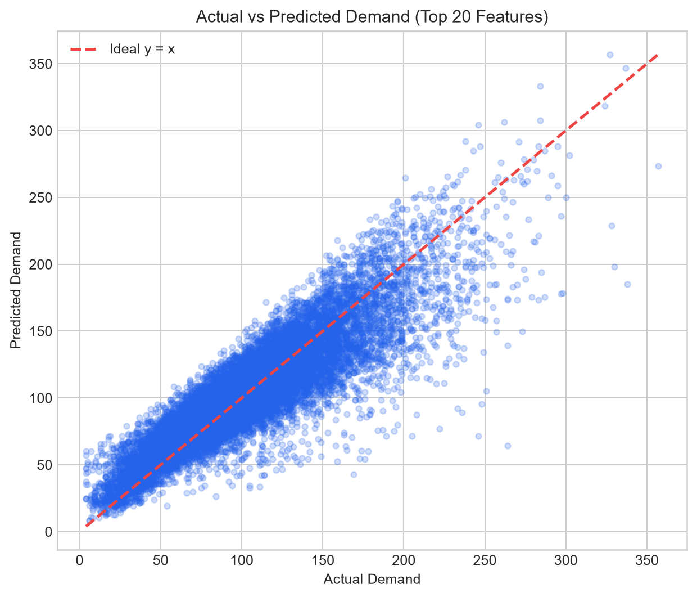
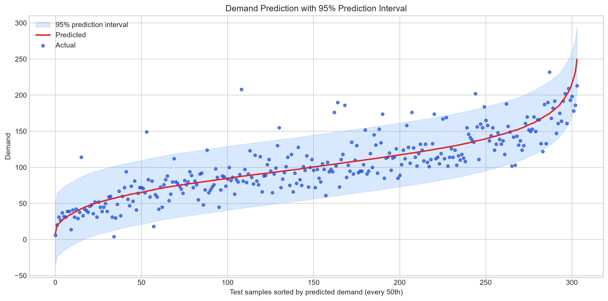

# 7115056075 HW2：零售需求多元線性回歸

本作業使用 Kaggle 的 **Retail Store Inventory and Demand Forecasting** 合成資料，依照 CRISP-DM 完成資料理解、資料準備、前 20 名特徵選擇、多元線性回歸、模型評估與部署規劃。

## 主要檔案

- 主程式：[`7115056075_hw2.ipynb`](./7115056075_hw2.ipynb)
- 報告：[`7115056075_hw2_report.pdf`](./7115056075_hw2_report.pdf)
- GPT 對話：[`ChatGPT-需求預測與特徵選擇-20261007-1014.pdf`](./ChatGPT-需求預測與特徵選擇-20261007-1014.pdf) 如果開不起來，可直接下載
- 原始資料：[`sales_data.csv`](./sales_data.csv)
- 可重建腳本：[`scripts/build_hw2_notebook.py`](./scripts/build_hw2_notebook.py)

## 資料來源與研究限制

- Kaggle：[Retail Store Inventory and Demand Forecasting](https://www.kaggle.com/datasets/atomicd/retail-store-inventory-and-demand-forecasting)
- 資料規模：76,000 筆、16 欄，其中 `Demand` 為預測目標、`Date` 不納入本次橫斷面回歸，候選原始特徵共 14 個。
- Kaggle 頁面標示此資料為合成資料，因此結果適合教學與方法展示，不能直接視為真實商店的營運成效。
- `Units Sold` 與 `Demand` 的業務定義可能互相接近；本作業保留它以符合預測任務，但不把係數解讀為因果關係。

## 實驗結果

資料先以 `random_state=42` 切成 80% 訓練集（60,800 筆）及 20% 測試集（15,200 筆）。前處理器與 `SelectKBest(f_regression, k=20)` 僅在訓練集擬合，以避免資料洩漏。

| 模型 | 特徵數 | MAE | RMSE | R² |
|---|---:|---:|---:|---:|
| 平均值基準模型 | 0 | 37.04 | 46.99 | -0.0000 |
| 全部編碼後特徵線性回歸 | 44 | 16.27 | 21.81 | 0.7845 |
| 前 20 名特徵線性回歸 | 20 | **16.55** | **22.20** | **0.7768** |

前 20 名模型只使用 20 個欄位，測試集表現與 44 個欄位模型接近；95% 預測區間實際涵蓋率為 **95.60%**，平均寬度為 88.28。涵蓋率接近名目值，但區間仍偏寬，表示單筆需求具有不可忽略的不確定性。

核心結果：**MAE = 16.55、RMSE = 22.20、R² = 0.7768**。

前 20 名特徵依 F-score 排序為：`Units Sold`、`Units Ordered`、`Epidemic`、`Category_Furniture`、`Category_Groceries`、`Promotion`、`Discount`、`Weather Condition_Sunny`、`Inventory Level`、`Weather Condition_Rainy`、`Seasonality_Summer`、`Category_Toys`、`Product ID_P0020`、`Weather Condition_Snowy`、`Seasonality_Spring`、`Product ID_P0009`、`Product ID_P0012`、`Product ID_P0017`、`Product ID_P0013`、`Category_Electronics`。





## CRISP-DM 流程

CRISP-DM（Cross-Industry Standard Process for Data Mining，跨產業資料探勘標準流程）不是只能依序執行一次的直線流程。分析人員在評估模型後，可能重新檢查商業問題、修改資料準備方式或更換模型。本作業依序說明六個階段，並將每一階段的目的、實際操作及產出對應到本次零售需求預測。

### 1. Business Understanding（商業理解）

#### 分析目標

零售商必須在庫存成本與缺貨風險之間取得平衡。備貨過多會增加倉儲及滯銷成本，備貨不足則可能造成銷售機會流失。因此，本研究的主要問題是：「能否根據商品、商店、價格、促銷、天氣與庫存等資訊，預測每筆紀錄的 `Demand`？」模型輸出除了需求點預測，也必須提供不確定性範圍，讓使用者知道預測可能產生多大的波動。

#### 實際作法

- 將 `Demand` 設為連續型目標變數，問題類型定義為監督式迴歸。
- 以 Multiple Linear Regression（多元線性回歸）作為主要模型，因為它容易實作，也能呈現各特徵與需求之間的線性關係。
- 建立平均值基準模型，避免只看單一模型分數而無法判斷模型是否真正具有預測能力。
- 依作業要求執行特徵選擇，從編碼後欄位中保留 F-score 重要性前 20 名。
- 使用 MAE、RMSE、R² 與 95% 預測區間作為成功判斷依據。

#### 階段產出與判讀

本階段確立了「可解釋的需求預測」是本次分析重點，而不是建立因果模型。`Units Sold` 與 `Demand` 的業務定義可能接近，因此即使它具有很高的預測重要性，也不能解釋為銷售量增加會直接造成需求增加。模型結果只用於比較預測能力；若要作為真實採購或補貨依據，仍必須使用真實營運資料重新驗證。

### 2. Data Understanding（資料理解）

#### 分析目標

資料理解階段的目的，是確認資料是否符合研究問題、欄位是否可用，以及是否存在缺失值、重複資料、異常範圍或資料來源限制。這一步能避免在不了解資料的情況下直接建模，導致錯誤解釋。

#### 實際作法

本研究讀取 `sales_data.csv`，檢查資料列數、欄數、欄位名稱、資料型態、缺失值、重複值及 `Demand` 的敘述統計。原始資料共有 76,000 筆、16 欄，檢查結果為 0 個缺失值與 0 筆完全重複資料。`Demand` 平均值約為 104.32、標準差約為 46.96，最小值為 4，最大值為 430，顯示目標變數具有明顯變動範圍。

16 個欄位中，`Demand` 是目標變數，`Date` 是日期欄位，其餘 14 個欄位作為原始候選特徵。候選特徵可分成下列三類：

- 數值欄位：`Inventory Level`、`Units Sold`、`Units Ordered`、`Price`、`Discount`、`Competitor Pricing`。
- 類別欄位：`Store ID`、`Product ID`、`Category`、`Region`、`Weather Condition`、`Seasonality`。
- 二元欄位：`Promotion`、`Epidemic`。

#### 階段產出與判讀

資料列數足以進行訓練集與測試集切分，且沒有缺失值需要插補。類別欄位不能直接輸入線性回歸，因此後續必須進行 One-Hot Encoding。Kaggle 頁面將此資料標示為合成資料，代表資料適合展示分析流程，但不能直接推論真實零售市場。此外，資料含有日期順序；本作業為符合一般多元線性回歸練習而採隨機切分，但實務預測應改用時間切分。

### 3. Data Preparation（資料準備）

#### 分析目標

資料準備階段要把原始欄位轉換成模型可接受的數值矩陣，同時防止資料洩漏。資料洩漏是指測試集資訊在訓練過程中被提前使用，會讓評估結果比實際部署表現更樂觀。

#### 實際作法

1. 移除本次橫斷面回歸不使用的 `Date`，並將 `Demand` 與候選特徵分開。
2. 使用 `train_test_split(test_size=0.2, random_state=42)`，先切出 60,800 筆訓練資料與 15,200 筆測試資料。
3. 數值欄位使用 `MinMaxScaler`，將不同量尺轉換到一致範圍；目標 `Demand` 保留原始單位，讓 MAE 與 RMSE 可以直接用需求量解釋。
4. 類別欄位使用 `OneHotEncoder(drop='first', handle_unknown='ignore')`，避免把 Store ID 或 Product ID 誤當成具有大小順序的數值。
5. `Promotion` 與 `Epidemic` 保留為二元數值；完成轉換後共有 44 個模型欄位。

前處理器只在訓練集執行 `fit`，再分別轉換訓練集與測試集。特徵名稱也由前處理器匯出，使後續排名、係數與圖表可以追溯回原始欄位。

#### 階段產出與判讀

本階段產出可供模型使用的訓練矩陣與測試矩陣。最重要的控制是「先切分、後擬合前處理器」，因此測試集沒有參與縮放範圍、類別集合或特徵選擇。這讓後續測試分數能更合理地代表模型面對未見資料時的表現。

### 4. Modeling（建模）

#### 分析目標

建模階段要回答兩個問題：第一，多元線性回歸是否優於只預測平均需求的簡單方法；第二，只保留重要性前 20 名特徵後，能否在降低欄位數量的同時維持接近全部特徵模型的預測能力。

#### 實際作法

特徵選擇採用 `SelectKBest(score_func=f_regression, k=20)`。`f_regression` 分別計算每個編碼後特徵與 `Demand` 的單變量線性 F-score，再依分數由高至低保留前 20 名。選擇器只在訓練集執行 `fit`，測試資料完全不參與排名。

本研究建立三個比較模型：

| 模型 | 使用欄位 | 比較目的 |
|---|---:|---|
| 平均值基準模型 | 0 | 所有測試資料都預測為訓練集平均值，作為最低比較標準 |
| 全部特徵線性回歸 | 44 | 檢查完整編碼後資料可達到的線性預測表現 |
| 前 20 名特徵線性回歸 | 20 | 評估特徵縮減後的效能與可解釋性 |

前 20 名依序包含 `Units Sold`、`Units Ordered`、`Epidemic`、商品類別、促銷、折扣、天氣、庫存、季節及部分 Product ID。模型使用 `sklearn.linear_model.LinearRegression` 產生測試預測；另外使用 `statsmodels.OLS` 擬合相同的前 20 名欄位，以取得整體統計量與預測區間。

#### 階段產出與判讀

本階段產出三組測試預測、前 20 名特徵清單、F-score 排名及 OLS 統計模型。F-test 是單變量篩選方法，容易理解且符合本次作業目的，但它不會自動處理特徵之間的冗餘，也不代表被選特徵具有因果效果。

### 5. Evaluation（評估）

#### 分析目標

評估階段不只確認模型分數，也要比較模型與基準的差異、檢查特徵選擇造成的效能變化，並利用殘差及預測區間說明模型的不確定性。

#### 實際作法

本研究在相同的 15,200 筆測試資料上計算三項指標：MAE 表示平均絕對誤差，單位與需求量相同；RMSE 對大型誤差給予較高懲罰；R² 表示模型相較平均值能解釋的變異比例。結果如下：

| 模型 | MAE | RMSE | R² |
|---|---:|---:|---:|
| 平均值基準模型 | 37.04 | 46.99 | -0.0000 |
| 全部 44 個欄位模型 | 16.27 | 21.81 | 0.7845 |
| 前 20 名特徵模型 | 16.55 | 22.20 | 0.7768 |

另外繪製實際值與預測值散點圖、殘差對預測值圖及殘差分布圖。前 20 名模型再以 OLS 計算 95% 預測區間；測試集實際涵蓋率為 95.60%，平均區間寬度為 88.28。

#### 階段產出與判讀

兩個線性回歸模型的誤差都明顯低於平均值基準，表示特徵確實提供預測資訊。前 20 名模型的 R² 比全部特徵模型低約 0.0077，但欄位由 44 個降為 20 個，因此在模型精簡與預測能力之間取得合理平衡。95% 預測區間涵蓋率接近名目值，但平均寬度仍大，說明單筆需求存在明顯不確定性。散點圖與殘差圖也顯示高需求區域仍可能出現較大誤差，因此不能只看 R² 就宣稱模型已適合實務部署。

### 6. Deployment（部署）

#### 分析目標

Deployment 在本作業中不是建立正式線上服務，而是確保分析能被重現、檢查及交付。若未來要實際部署，還需要定義輸入格式、版本控制、監測方式與重新訓練條件。

#### 實際作法

- 以 `7115056075_hw2.ipynb` 保存完整分析步驟、程式與執行輸出。
- 以 `results/metrics.json`、`model_comparison.csv` 與 `top20_features.csv` 保存可機器讀取的模型結果。
- 將實際值與預測值、95% 預測區間及殘差診斷輸出到 `results/`，讓報告與程式使用相同來源。
- 以 README 記錄資料來源、CRISP-DM 流程、GPT 輔助內容、NotebookLM 摘要、執行方式與研究限制。
- 保留 Notebook 產生腳本與測試，確認欄位數、切分順序、前 20 名特徵及輸出檔案一致。

#### 階段產出與判讀

目前成果適合課堂作業重現，但不等於已完成商業部署。真實環境應按照日期進行時間切分或滾動驗證，避免未來資料進入訓練集；也應檢查新類別、缺失值、資料漂移與極端需求。若真實資料呈現非線性關係，可在相同時間切分下比較 Ridge、Lasso、HistGradientBoostingRegressor 或時間序列模型。部署後應持續監測 MAE、RMSE、預測區間涵蓋率及資料分布，當表現明顯下降時再重新訓練。

## GPT 輔助內容

GPT 協助整理作業需求、Notebook 結構、資料洩漏防護、前 20 名特徵選擇、模型比較、預測區間、報告排版與驗證。完整對話已匯出為 PDF；所有數值均由 Notebook 實際執行產生，未以對話內容替代實驗結果。

## NotebookLM 摘要

NotebookLM 研究顯示，零售需求預測通常不只比較單一模型，而會依資料型態選擇線性模型、樹模型或時間序列方法。線性回歸容易解釋各欄位與需求的關聯，可作為清楚的基準；Ridge 可降低高度相關特徵造成的係數不穩定，Lasso 可透過稀疏係數進行內嵌式特徵選擇。若需求與促銷、天氣及商品類別之間存在非線性互動，可再比較梯度提升樹。具有日期順序的零售資料則應採時間切分或滾動驗證，避免隨機切分把未來資訊混入訓練資料。模型評估除了 MAE、RMSE 與 R²，也應呈現預測區間，讓管理者同時掌握點預測與缺貨風險。這些研究結果支持本作業以多元線性回歸建立可解釋基準，並把正則化、非線性模型及時間驗證列為後續改進方向。

## 主流或更優方法比較

| 方法 | 優點 | 本作業中的用途或限制 |
|---|---|---|
| Ridge Regression | 對高度相關特徵加入 L2 正則化，係數較穩定 | 適合檢查 One-Hot 與連續特徵共線性；需交叉驗證選擇強度 |
| Lasso Regression | L1 正則化可把部分係數壓成 0 | 可與 F-test 的前 20 名選擇比較；結果受縮放與超參數影響 |
| HistGradientBoostingRegressor | 能捕捉非線性與特徵交互作用，適合大型表格資料 | 可能提升預測，但解釋性低於線性回歸 |
| ARIMA／SARIMA | 直接利用時間相依性與季節性 | 應先依商店與商品整理時間序列，不能沿用本次隨機切分 |

以上方法僅做文獻與方法比較，未在本作業中宣稱其測試分數優於目前模型。

## 執行方式

```powershell
python -m pip install -r requirements.txt
python scripts/build_hw2_notebook.py
jupyter nbconvert --to notebook --execute 7115056075_hw2.ipynb --output 7115056075_hw2.ipynb --ExecutePreprocessor.timeout=600
python -m pytest tests/test_hw2_artifacts.py -q
```

執行 Notebook 後，量化結果會寫入 `results/metrics.json`、`results/model_comparison.csv` 與 `results/top20_features.csv`；圖表會寫入 `results/`。

## 參考資料

- [scikit-learn：SelectKBest](https://scikit-learn.org/stable/modules/generated/sklearn.feature_selection.SelectKBest.html)
- [scikit-learn：f_regression](https://scikit-learn.org/stable/modules/generated/sklearn.feature_selection.f_regression.html)
- [scikit-learn：LinearRegression](https://scikit-learn.org/stable/modules/generated/sklearn.linear_model.LinearRegression.html)
- [scikit-learn：Linear models（Ridge、Lasso）](https://scikit-learn.org/stable/modules/linear_model.html)
- [scikit-learn：HistGradientBoostingRegressor](https://scikit-learn.org/stable/modules/generated/sklearn.ensemble.HistGradientBoostingRegressor.html)
- [statsmodels：PredictionResults.summary_frame](https://www.statsmodels.org/stable/generated/statsmodels.regression.linear_model.PredictionResults.summary_frame.html)
