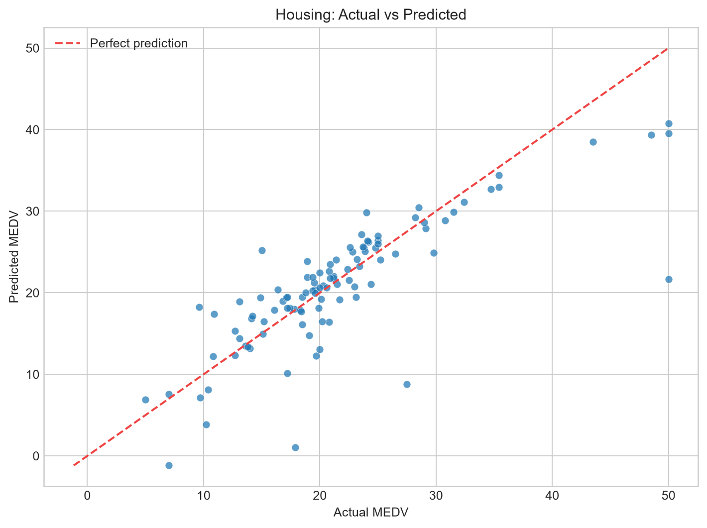
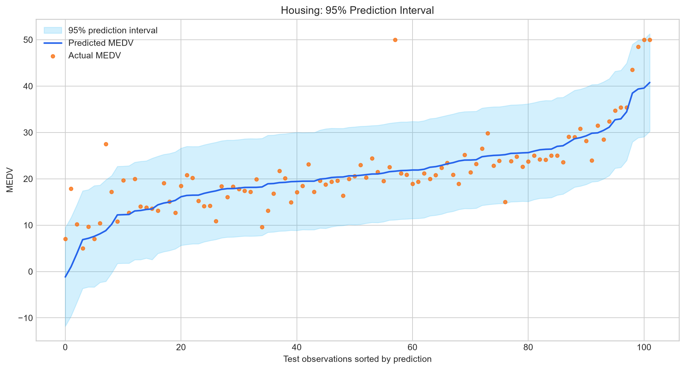
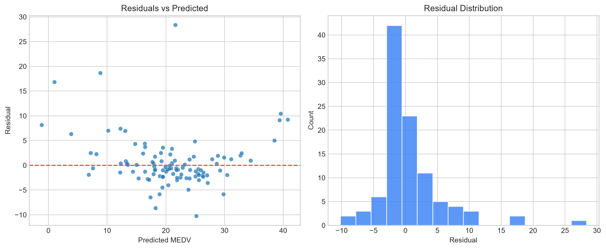

# Housing Data：房價多元線性回歸

本資料夾以 Boston Housing 格式的 `HousingData.csv` 建立房價預測流程。預測目標為 `MEDV`，代表住宅價格中位數；其餘 13 個欄位都是候選特徵。分析採用可解釋的多元線性回歸，並依訓練資料的 `f_regression` 分數選出前 7 個特徵作為正式主模型。

Housing 不另外製作 DOCX 或 PDF report。本 README、`housing_analysis.ipynb`、`results/` 與網站頁面就是完整成果與可重現紀錄。

## 主要檔案

- 原始資料：[`HousingData.csv`](./HousingData.csv)
- 正式 Notebook：[`housing_analysis.ipynb`](./housing_analysis.ipynb)
- Notebook 建立器：[`scripts/build_housing_notebook.py`](./scripts/build_housing_notebook.py)
- 指標：[`results/metrics.json`](./results/metrics.json)
- 模型比較：[`results/model_comparison.csv`](./results/model_comparison.csv)
- 前 7 特徵：[`results/top7_features.csv`](./results/top7_features.csv)

## 資料與實驗設定

資料共有 506 筆、14 欄，其中 13 欄為候選特徵，`MEDV` 為目標。資料共有 120 個缺失值，分布在 `CRIM`、`ZN`、`INDUS`、`CHAS`、`AGE` 與 `LSTAT`，每欄各 20 個；`MEDV` 沒有缺失值，資料也沒有完全重複列。

實驗以 `random_state=42` 做 80/20 隨機切分，得到 404 筆訓練資料與 102 筆測試資料。所有中位數填補、Min-Max scaling（最小最大縮放）與特徵選擇都只在訓練集擬合；測試集只能使用已學到的轉換參數，以避免資料洩漏。

`MEDV` 的整體平均值約為 22.53、標準差約為 9.20，最小值為 5.0，中位數為 21.2，最大值為 50.0。資料中的價格上限現象會限制線性回歸對高價住宅的擬合能力，因此評估時不能只看單一平均誤差。

## 實際模型結果

| 模型 | 特徵數 | MAE | RMSE | R² |
|---|---:|---:|---:|---:|
| 訓練集平均值基準 | 0 | 6.26 | 8.66 | -0.0233 |
| 全部 13 特徵線性回歸 | 13 | 3.15 | 5.00 | 0.6593 |
| 前 7 特徵線性回歸（正式主模型） | 7 | **3.13** | **5.11** | **0.6433** |

正式主模型結果為 **MAE = 3.13、RMSE = 5.11、R² = 0.6433**。相較於全部 13 特徵模型，前 7 特徵模型把輸入數量由 13 個降到 7 個，MAE 略微改善，RMSE 與 R² 則小幅下降。這表示較精簡的模型保留了大部分解釋能力，但仍需誠實呈現它不是所有指標都優於完整模型。

依 F-score 排序選出的前 7 名為：

1. `LSTAT`：低社經地位人口比例。
2. `RM`：每戶平均房間數。
3. `PTRATIO`：學生與教師比例。
4. `TAX`：財產稅率。
5. `INDUS`：非零售商業用地比例。
6. `NOX`：一氧化氮濃度。
7. `RAD`：放射狀公路可及性指數。

訓練集 OLS 模型的 R² 為 0.6838，Adjusted R² 為 0.6782。測試資料的 95% 預測區間覆蓋率為 **97.06%**，平均區間寬度為 21.01。覆蓋率高於名目 95%，但區間相對寬，代表模型能表達不確定性，單筆預測仍不適合被解讀為精確價格。







## CRISP-DM 流程

### 1. Business Understanding（商業理解）

#### 分析目標

本問題要回答的是：能否用住宅區環境、交通、稅率、人口與房屋結構欄位，建立容易說明且可在網站即時運算的房價預測模型。`MEDV` 被定義為預測目標，MAE、RMSE 與 R² 用來衡量點預測品質，95% 預測區間則用來呈現單筆預測的不確定性。

#### 實際作法

模型選用多元線性回歸，理由是訓練成本低、係數可解釋，而且能將縮放參數、截距與係數匯出成 JSON，直接在 GitHub Pages 的瀏覽器中運算。為了和使用全部欄位的模型比較，也建立平均值基準與全部 13 特徵模型。

#### 階段產出與判讀

正式目標不是追求最高分的黑箱模型，而是在合理預測能力、較少輸入欄位與可解釋性之間取得平衡。若未來需要更高準確度，可再加入 Ridge、Lasso、Random Forest 或 Gradient Boosting，但必須以相同測試切分或交叉驗證公平比較。

### 2. Data Understanding（資料理解）

#### 分析目標

確認資料筆數、欄位名稱、資料型態、缺失值、重複列與 `MEDV` 的分布，避免在不了解資料品質時直接建模。

#### 實際作法

程式驗證欄位順序必須為 `CRIM`、`ZN`、`INDUS`、`CHAS`、`NOX`、`RM`、`AGE`、`DIS`、`RAD`、`TAX`、`PTRATIO`、`B`、`LSTAT` 與 `MEDV`。字串 `NA` 會在讀取時轉成缺失值，原始 CSV 不會被覆寫。

#### 階段產出與判讀

506 筆資料足以建立基準迴歸，但對複雜模型仍屬小型資料集。120 個缺失值不能直接刪除，否則樣本數會進一步下降並可能改變資料分布，因此採用訓練集中位數填補。

### 3. Data Preparation（資料準備）

#### 分析目標

產生不含資料洩漏且能重現的訓練與測試矩陣，同時讓不同量尺的特徵可放入同一模型與網站公式。

#### 實際作法

先用固定亂數種子切分資料，再建立包含 `SimpleImputer(strategy="median")` 與 `MinMaxScaler()` 的 pipeline。pipeline 只對 `X_train` 執行 `fit_transform`，對 `X_test` 僅執行 `transform`。這表示測試資料的中位數、最小值與最大值不會影響模型。

#### 階段產出與判讀

訓練矩陣為 404 × 13，測試矩陣為 102 × 13。網站需要的訓練集中位數、縮放範圍與平均值都保存在 `results/metrics.json`，不需要在前端手動猜測。

### 4. Modeling（建模）

#### 分析目標

從 13 個候選特徵中固定選出前 7 名，並判斷欄位精簡後是否仍保留足夠預測能力。

#### 實際作法

`SelectKBest(score_func=f_regression, k=7)` 只使用訓練資料計算每個特徵與 `MEDV` 的單變量線性關聯。選出的欄位依序為 `LSTAT`、`RM`、`PTRATIO`、`TAX`、`INDUS`、`NOX` 與 `RAD`。正式模型使用這 7 個縮放後欄位訓練 `LinearRegression`，並以相同欄位建立 `statsmodels.OLS` 取得統計量與預測區間。

#### 階段產出與判讀

F-score 代表單一特徵與目標的線性關聯強度，不等同於多變量模型中的因果重要性。網站呈現的係數是在 Min-Max 縮放後尺度上計算，適合比較模型內方向與相對影響，但不能被解讀成改變環境特徵就必然造成相同幅度的房價變化。

### 5. Evaluation（評估）

#### 分析目標

以未參與擬合的 102 筆測試資料比較三個模型，並檢查點預測、殘差與預測區間。

#### 實際作法

MAE 顯示平均絕對偏差，RMSE 對較大的預測誤差更敏感，R² 表示模型相對於平均值基準可解釋的變異比例。另以 OLS 的 observation interval 計算測試集 95% 預測區間覆蓋率和平均寬度，並輸出實際值對預測值、排序後區間與殘差診斷三張圖。

#### 階段產出與判讀

前 7 特徵主模型的 R² 為 0.6433，明顯優於平均值基準，但仍有約三分之一以上變異未被線性模型解釋。97.06% 的區間覆蓋率不能單獨代表模型很好，還必須搭配 21.01 的平均區間寬度一起解讀。

### 6. Deployment（部署）

#### 分析目標

讓模型成果可在不具 Python 後端的 GitHub Pages 網站使用，並確保網站數字可以追溯到實際 Notebook 輸出。

#### 實際作法

Notebook 匯出模型指標、前 7 特徵、填補值、縮放範圍、截距與係數。Next.js 網站讀取獨立的 Housing JSON，在瀏覽器端完成與 Python 相同的填補、縮放與線性公式，圖片則放在 Housing 專屬子資料夾。

#### 階段產出與判讀

部署內容為靜態 HTML、CSS、JavaScript、JSON 與 PNG，不依賴 API Routes、Server Actions、資料庫或持續運行的 Python 服務。網站預測是課堂分析展示用途，不應用於貸款、估價或其他高風險決策。

## 方法限制

- 資料筆數只有 506 筆，而且來源欄位反映特定年代與地區，不能直接代表目前所有房市。
- `MEDV` 最高值為 50，可能存在截尾效應；線性模型對高價區間的誤差會較明顯。
- F-score 是單變量篩選，沒有直接處理特徵之間的共線性與交互作用。
- 隨機 80/20 切分只提供一次估計；更完整的研究可增加重複交叉驗證與外部測試資料。
- 線性係數顯示關聯，不證明因果；環境與人口欄位尤其不應做超出資料範圍的政策推論。

## 重現方式

在本資料夾執行：

```powershell
python -m pip install -r requirements.txt
python scripts/build_housing_notebook.py
python -m jupyter nbconvert --to notebook --execute housing_analysis.ipynb --output housing_analysis.ipynb --ExecutePreprocessor.timeout=600
python -m pytest tests -q
```

若系統找不到 `python`，請改用已安裝 Python 的完整路徑。成功執行後，`results/` 會重新產生 JSON、兩個 CSV 與三張 PNG；README 中的數值應再與新結果核對。
